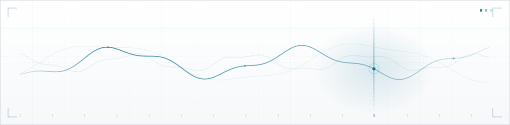

# OLIVERBUDDY

`OB—01` · `OFFLINE BUILDER`

**在离线处建造，让工具保持安静。**

<sub>`MOBILE TOOLS` · `LOCAL CRYPTO` · `MARKET WIDGETS`</sub>

<p align="center">
  <picture>
    <source media="(prefers-color-scheme: dark) and (max-width: 600px)" srcset="assets/hero-mobile-dark.svg">
    <source media="(prefers-color-scheme: light) and (max-width: 600px)" srcset="assets/hero-mobile-light.svg">
    <source media="(prefers-color-scheme: dark)" srcset="assets/hero-dark.svg">
    <source media="(prefers-color-scheme: light)" srcset="assets/hero-light.svg">
    
  </picture>
</p>

## ARCHIVE / 造物

<!-- PROJECTS:START -->
- `01` **[private_notes](https://github.com/oliverbuddy/private_notes)** — 小记 · 手机端 Markdown 笔记（Flutter） · `Dart` · 2026.11

<sub>AUTO-SYNC · 非 fork / 非归档 / 有描述 · 每日刷新 · <a href="https://github.com/oliverbuddy/oliverbuddy/blob/main/scripts/profile_config.json">筛选规则</a> · <a href="https://github.com/oliverbuddy?tab=repositories">全部仓库 →</a></sub>
<!-- PROJECTS:END -->

## TELEMETRY / 信号

<!-- STATS:START -->
```console
REPOS     1         STARS     0
FOLLOWERS 6         SINCE     2015
MAIN      Dart
```

<sub>数字来自 GitHub API（不含 profile 仓库）· 每日自动刷新</sub>
<!-- STATS:END -->

<p align="center">
  <sub>LIVE FEED / 贡献轨迹</sub><br>
  <picture>
    <source media="(prefers-color-scheme: dark)" srcset="https://raw.githubusercontent.com/oliverbuddy/oliverbuddy/output/github-contribution-grid-snake-dark.svg">
    <source media="(prefers-color-scheme: light)" srcset="https://raw.githubusercontent.com/oliverbuddy/oliverbuddy/output/github-contribution-grid-snake.svg">
    
  </picture>
  <br>
  <sub>若动画未加载，可查看 <a href="https://github.com/oliverbuddy/oliverbuddy/tree/output">output 分支</a></sub>
</p>

## UPLINK / 联络

`MAIL` [qiwei0727@163.com](mailto:qiwei0727@163.com) · `GITHUB` [@oliverbuddy](https://github.com/oliverbuddy) · `REPOS` [全部公开仓库](https://github.com/oliverbuddy?tab=repositories)

<p align="center">
  <sub>END OF TRANSMISSION</sub>
</p>
